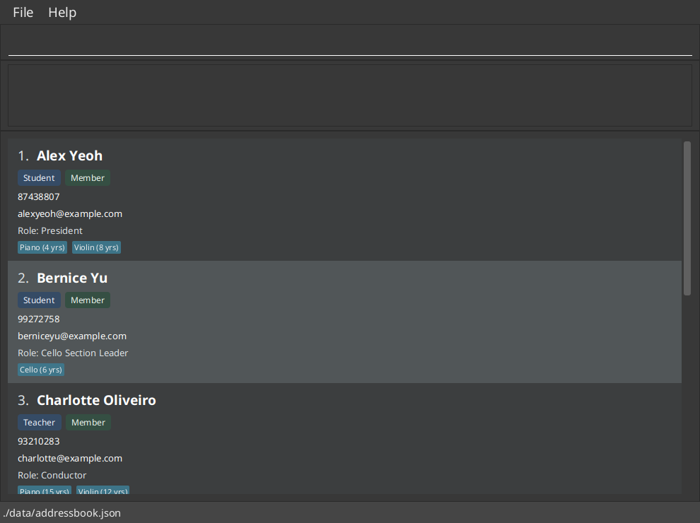
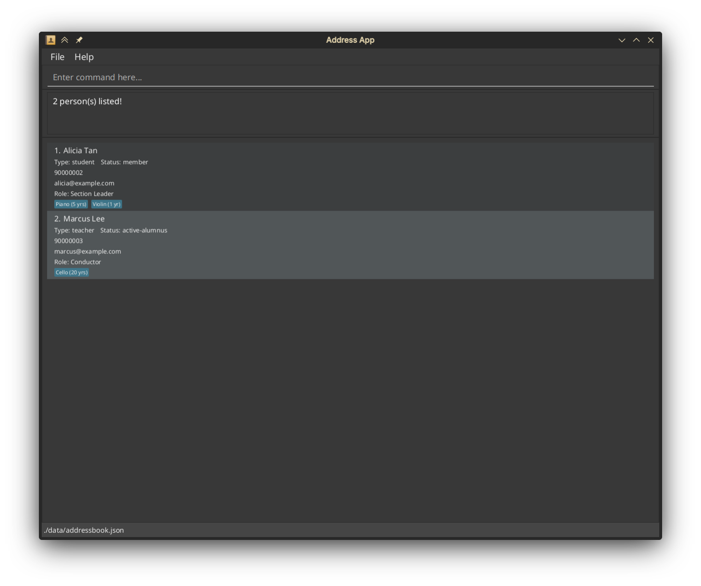

HiveMind is a **desktop directory for Music CCA members and alumni, optimized for use through a Command Line Interface (CLI)** while retaining the benefits of a Graphical User Interface (GUI). It helps coordinators view contact details, membership information, roles, and musical experience in one place. HiveMind is adapted from AddressBook Level 3 (AB3).

* Table of Contents
{:toc}

--------------------------------------------------------------------------------------------------------------------

## Quick start

1. Ensure that Java `25` or later is installed on your computer. 
   **Mac users:** Ensure you have the precise JDK version prescribed [here](https://se-education.org/guides/tutorials/javaInstallationMac.html).

1. Download the latest `.jar` file from the [HiveMind releases page](https://github.com/AY2627S1-CS2103T-T10-3/tp/releases).

1. Copy the file to the folder you want to use as the _home folder_ for HiveMind.

1. Open a terminal, `cd` to the folder containing the JAR file, and run `java -jar addressbook.jar`. 
   A GUI similar to the one below should appear in a few seconds. On first launch without a data file, the app contains sample records. The screenshot shows an example directory; your records may differ. 
   

1. Type a command in the command box and press Enter to execute it. For example, type **`help`** and press Enter to open the help window. 
   Some example commands you can try:

   * `list` : Shows all members and their recorded details.

   * `add n/John Doe p/98765432 e/johnd@example.com s/member` : Adds a current member named `John Doe`.

   * `delete 3` : Deletes the 3rd contact shown in the current list.

   * `clear` : Deletes all contacts.

   * `exit` : Exits the app.

1. Refer to the [Features](#features) section below for details of each command.

--------------------------------------------------------------------------------------------------------------------

## Features

**:information_source: Notes about the command format:** 

* Words in `UPPER_CASE` are the parameters to be supplied by the user. 
  For example, in `add n/NAME`, replace `NAME` with a value such as `John Doe`.

* Items in square brackets are optional. 
  For example, `n/NAME [r/ROLE]` can be used as `n/John Doe r/Section Leader` or as `n/John Doe`.

* Items followed by `…`​ can appear zero or more times. 
  For example, `[i/INSTRUMENT:YEARS]…​` may be omitted, or written as `i/Violin:5` or `i/Violin:5 i/Piano:2`.

* Parameters can be in any order. 
  For example, if the command specifies `n/NAME p/PHONE_NUMBER`, `p/PHONE_NUMBER n/NAME` is also acceptable.

* Extraneous parameters for commands that take no parameters, such as `help`, `list`, `exit`, and `clear`, are ignored. 
  For example, `help 123` is interpreted as `help`.

* If you are using a PDF version of this document, be careful when copying and pasting commands that span multiple lines as space characters surrounding line-breaks may be omitted when copied over to the application.

### Viewing help: `help`

Shows a message explaining how to access the help page.

Format: `help`

### Adding a person: `add`

Adds a person to the address book.

Format: `add n/NAME p/PHONE_NUMBER e/EMAIL s/STATUS [ty/TYPE] [r/ROLE] [i/INSTRUMENT:YEARS]…​`

* `s/STATUS` is required: use `member`, `active-alumnus`, or `inactive-alumnus`. Status is case-insensitive.
* `ty/TYPE` is optional: use `student` or `teacher`. It defaults to `student` when omitted.
* `r/ROLE` is optional free text, such as `Section Leader`. It cannot be blank.
* Type and status appear beneath the member's name on the card. If a role is supplied, it appears beneath the contact details; otherwise, the role line is hidden.
* `i/INSTRUMENT:YEARS` records an instrument the person plays and how many whole years they have played it, from `0` to `99`. For example, `i/Violin:5` or `i/Bass Guitar:1`.
* Instrument names cannot be blank or contain `:`. Each instrument can be listed only once per person; names are compared ignoring case, so `Violin` and `violin` count as the same instrument.

:bulb: **Tip:**
A person can have any number of instruments, including zero.

Examples:
* `add n/John Doe p/98765432 e/johnd@example.com s/member`
* `add n/Betsy Crowe p/1234567 e/betsy@example.com s/active-alumnus ty/teacher r/Conductor i/Violin:12 i/Piano:4`

### Listing all persons: `list`

Shows all members and alumni in the directory, in insertion order. Use this command after `find` or `filter` to return to the full list.

Format: `list`

Each member card displays:

* The member's displayed index and name.
* Member type (`student` or `teacher`) and membership status (`member`, `active-alumnus`, or `inactive-alumnus`).
* Phone number and email address.
* A `Role:` line when a role is recorded. No role line is shown when it is absent.
* Recorded instruments and their years of experience, sorted alphabetically by instrument name, ignoring case. For example, `Violin (1 yr)` and `Piano (5 yrs)`. No instrument labels appear when none are recorded.

The same card details are shown in `find` and `filter` results. Displayed indices start at `1` and refer to the current list, so a member's index may change after a search or filter. Use the current displayed index for commands such as `edit` and `delete`.

Example: after `find alicia marcus`, enter `list` to show everyone again. The result message is `Listed all persons.`

### Editing a person: `edit`

Edits an existing person in the address book.

Format: `edit INDEX [n/NAME] [p/PHONE] [e/EMAIL] [i/INSTRUMENT:YEARS]…​`

* Edits the person at the specified `INDEX`. The index refers to the index number shown in the displayed person list. The index **must be a positive integer** 1, 2, 3, …​
* At least one of the optional fields must be provided.
* Existing values will be updated to the input values.
* Status, member type, and role are preserved when editing a person's name, phone, email, or instruments.
* Instruments are preserved when they are not edited.
* When editing instruments, all of the person's existing instruments are replaced; adding instruments is not cumulative.
* To remove all of a person's instruments, enter `i/` without an instrument after it.

Examples:
*  `edit 1 p/91234567 e/johndoe@example.com` Edits the phone number and email address of the 1st person to be `91234567` and `johndoe@example.com` respectively.
*  `edit 2 n/Betsy Crower i/` Edits the name of the 2nd person to be `Betsy Crower` and clears all existing instruments.
*  `edit 3 i/Cello:6 i/Piano:2` Replaces the instruments of the 3rd person with Cello (6 years) and Piano (2 years).

### Locating persons by name: `find`

Finds persons whose names contain any of the given keywords, including partial words.

Format: `find KEYWORD [MORE_KEYWORDS]…`

* The search is case-insensitive; for example, `hans` matches `Hans`.
* Keyword order does not matter; for example, `Hans Bo` matches `Bo Hans`.
* The search considers only names.
* Keywords can match any part of a name; for example, `ali` and `lic` both match `Alice`.
* Persons matching at least one keyword are returned (an `OR` search); for example, `Hans Bo` returns `Hans Gruber` and `Bo Yang`.
* Matching cards retain all recorded details and are numbered from `1`. The result message reports the number of matches. If nothing matches, the list is empty.
* Use `list` to display everyone again.

Examples, assuming the named members are in your directory:

* `find ali` matches `Alicia Tan`, demonstrating partial-name matching.
* `find alicia marcus` matches `Alicia Tan` and `Marcus Lee`. In the example directory below, these are the only matches, so the result is `2 person(s) listed!` with cards numbered `1` and `2`.

### Filtering persons by instrument: `filter`

Format: `filter i/INSTRUMENT [i/INSTRUMENT]...`

Shows people who play any of the specified instruments and reports the number of matches.

* Accepts one or more instrument names, each introduced by `i/`. Years played are not used when filtering.
* Instruments are combined with OR: `filter i/Violin i/Viola` matches people who play either instrument or both.
* Matches complete instrument names, ignoring case: `guitar` matches `Guitar`, but not `Bass Guitar`.
* Spaces after `i/` are allowed: `filter i/ Violin` is equivalent to `filter i/Violin`.
* Only `i/` is accepted for now; other prefixes such as `s/` or `n/` are rejected with the command format.
* Searches the full directory, including after a previous `find` or `filter`.
* If no person matches, the displayed list is empty and the result reports zero matches.
* Stored records are unchanged. Use `list` to display everyone again.

Example: `filter i/Violin`

### Deleting a person: `delete`

Deletes the specified person from the address book.

Format: `delete INDEX`

* Deletes the person at the specified `INDEX`.
* The index refers to the index number shown in the displayed person list.
* The index **must be a positive integer** 1, 2, 3, …​

Examples:
* `list` followed by `delete 2` deletes the 2nd person in the address book.
* `find Betsy` followed by `delete 1` deletes the 1st person in the results of the `find` command.

### Clearing all entries: `clear`

Clears all entries from the address book.

Format: `clear`

### Exiting the program: `exit`

Exits the program.

Format: `exit`

### Saving the data

AddressBook automatically saves data after every command. You do not need to save manually.

### Editing the data file

AddressBook data is saved automatically as a JSON file `[JAR file location]/data/addressbook.json`. Advanced users are welcome to update data directly by editing that data file.

:exclamation: **Caution:**
If your changes make the data file invalid, AddressBook starts with an empty address book at the next run. The invalid file remains on disk until you run a command (AddressBook saves after every command). Still, we recommend backing up the file before editing it. 
Furthermore, certain edits can cause the AddressBook to behave in unexpected ways (e.g., if a value entered is outside of the acceptable range). Therefore, edit the data file only if you are confident that you can update it correctly.

### Archiving data files `[coming in v2.0]`

_Details coming soon ..._

--------------------------------------------------------------------------------------------------------------------

## FAQ

**Q**: How do I transfer my data to another computer? 
**A**: Install the app on the other computer and overwrite the data file it creates with the data file from your previous AddressBook home folder.

--------------------------------------------------------------------------------------------------------------------

## Known issues

1. **When using multiple screens**, if you move the application to a secondary screen, and later switch to using only the primary screen, the GUI will open off-screen. The remedy is to delete the `preferences.json` file created by the application before running the application again.
2. **If you minimize the Help Window** and then run the `help` command (or use the `Help` menu, or the keyboard shortcut `F1`) again, the original Help Window will remain minimized, and no new Help Window will appear. The remedy is to manually restore the minimized Help Window.

--------------------------------------------------------------------------------------------------------------------

## Command summary

Action | Format, Examples
--------|------------------
**Add** | `add n/NAME p/PHONE_NUMBER e/EMAIL s/STATUS [ty/TYPE] [r/ROLE] [i/INSTRUMENT:YEARS]…​`   e.g., `add n/James Ho p/22224444 e/jamesho@example.com s/member r/Section Leader i/Trumpet:3`
**Clear** | `clear`
**Delete** | `delete INDEX`  e.g., `delete 3`
**Edit** | `edit INDEX [n/NAME] [p/PHONE_NUMBER] [e/EMAIL] [i/INSTRUMENT:YEARS]…​`  e.g., `edit 2 n/James Lee e/jameslee@example.com`
**Find** | `find KEYWORD [MORE_KEYWORDS]…`  e.g., `find alicia marcus`
**Filter** | `filter i/INSTRUMENT [i/INSTRUMENT]...`  e.g., `filter i/Violin i/Viola`
**List** | `list`
**Help** | `help`
